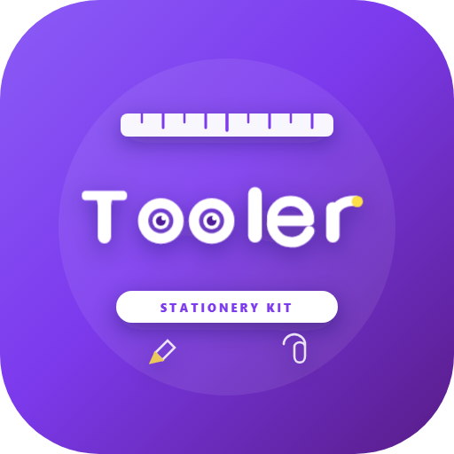

<div align="center">

  

  # Tooler ✂️📏📎
  **Aesthetic, Minimal & Ultra-Fast Multi-Utility Suite for Android**

  [](https://flutter.dev)
  [](https://dart.dev)
  [](https://github.com/AyushHarinkhede/Tooler)
  [](LICENSE)
  [](Tooler.apk)
  [](https://github.com/AyushHarinkhede)

  <p align="center">
    <b>Tooler</b> is a distraction-free, privacy-first mobile toolkit combining precision calculators, screen calipers, unit converters, sensor tools, and productivity helpers into one cohesive, tactile experience.
  </p>

</div>

---

## 🌟 Highlights & Philosophy

- **Zero Clutter & Zero Ads:** 100% free of advertisements, telemetry SDKs, and third-party trackers.
- **100% Offline & Private:** All data, counters, notes, and calculation histories stay strictly on-device in sandboxed storage.
- **Resilient Background Epoch Engine:** Active Timers and Stopwatches survive process kills and RAM clearing using wall-clock epoch synchronization.
- **Tactile Sound & Spring Physics:** Satisfying click sounds, haptic feedback pulses, and spring tap micro-interactions on every tool.
- **Universal Smart Search:** Instant deep search across all tool sections and sub-features directly from the home header.

---

## 🛠️ Core Feature Modules

### 🧮 1. Precision Calculators
- **Standard & Scientific:** Trigonometry (`sin`, `cos`, `tan`), logarithms (`ln`, `log`), roots, powers (`x^y`), factorial (`!`), constants ($\pi$, $e$).
- **Programmer Mode:** Real-time conversion across **BIN**, **OCT**, **DEC**, and **HEX** with bitwise operations (`AND`, `OR`, `XOR`, `NOT`, `LSH`, `RSH`).
- **Interactive Easter Eggs:** Dynamic badges for notable answers (*Thala for a reason*, *Nothing*, *Never Settle*, *Ask your ChatBot*).
- **Live Clock:** Hold the clear (`C`) key for 2–3 seconds to inspect the live real-time digital clock.
- **Hardware Keyboard Support:** Full support for external physical keyboards with digit typing, Enter (`=`), Esc (`C`), and operators.

### 🎂 2. Age Calculator & Life Milestones
- **Precise Chronology:** Computes exact age down to years, months, days, hours, minutes, and seconds.
- **Dynamic Legal Eligibility:** Clear visual indicator badges (Drive at 18+, Vote at 18+, Marriage at 18+/21+, Alcohol at 21+).
- **Milestone Badges:** Celebrates *Quarter Century* (25y), *Half Century* (50y), *Full Century* (100y), and *Immortal* (150y+).
- **Direct Age Selector:** Instant numerical picker for birthdate configuration.

### 📏 3. Physical Sizers & Calibrated Ruler
- **Ring Sizer Caliper:** Calibrate physical rings against on-screen benchmark circles with formula reference:
  $$\text{Circumference} = \text{Diameter} \times \pi$$
- **Bangle Sizer:** Circular screen guide to measure bangle diameter directly.
- **Watch Strap Scale:** High-precision SVG visual ruler for watch strap sizing.
- **Fullscreen Scrollable Ruler:** Real-time edge ruler extending beyond 300+ cm with mm, cm, inches, and meter scales. Includes bookmark pin drops and coordinate readout.

### ⏱️ 4. Stopwatch & Countdown Timer
- **Background Persistence:** Computes elapsed time upon relaunch even if the app was swiped from RAM or the device restarted.
- **Repeating Alarm Ring:** Distinct continuous alarm tone rings when timer expires with a dedicated "Stop Alarm" action.
- **Split Lap Analytics:** Stopwatch with dual-ring analogue dial, split laps, and fastest/slowest highlight splits.
- **System Notifications:** High-priority heads-up background alerts on timer completion and stopwatch milestones.

### 🔄 5. Universal Unit Converters
- **17 Precision Categories:** Length, Mass/Weight, Temperature, Area, Volume, Speed, Time, Digital Storage, Pressure, Energy, Power, Fuel Economy, Angle, Frequency, Typography, Density, and Height.
- **Instant Two-Way Sync:** Real-time updates across source and target units with copyable results.

### 🧭 6. Compass & Dual-Axis Spirit Level
- **Real-Time Magnetic Azimuth:** Smooth compass dial with cardinal headings (N, NE, E, SE, S, SW, W, NW).
- **Surface Leveler:** Calibrated pitch and roll bubble indicators with angle inclination readouts.

### 🎙️ 7. Sound Studio & Audio Memos
- **Live Waveform Visualizer:** Real-time audio waveform rendering during microphone recording.
- **Memo Player:** Playback speed control ($0.5\times$ to $2.0\times$), bookmark scrubbers, and category tags.

### 📌 8. Tasks & Due Date Reminders
- **Date & Time Picker:** Schedule exact due dates and times for your tasks and assignments.
- **Timely System Alerts:** Local notification alerts prompt you to mark tasks complete when due.
- **Task Complete Chime:** Celebratory audio chime and tactile haptic pulse upon checking off items.

### 🎨 9. Aesthetic Theme Customization
- **Modern Obsidian Dark & Clean Light Modes.**
- **5 Accent Palettes:** Lilac Violet, Soft Blush Rose, Sage Mint, Ocean Sky, and Sunset Amber.
- **Bouncy Physics:** Tactile button bounce on every tap with smooth cubic page transitions.

---

## 🔒 Privacy & Permissions

| Permission | Purpose |
|:---|:---|
| `POST_NOTIFICATIONS` | Alerts you when a countdown timer finishes or a scheduled task is due. |
| `VIBRATE` | Provides tactile haptic feedback during button taps and dial interactions. |
| `RECORD_AUDIO` | Used strictly on-device inside the Audio Memo tool (no internet transmission). |
| `ACCESS_COARSE/FINE_LOCATION` | Required by Android for the digital magnetic compass sensor calibration. |

> **Privacy Commitment:** Tooler does **not** collect, store, or transmit your personal data. Everything is processed strictly on your device.

---

## 🏗️ Tech Stack

- **Framework:** [Flutter](https://flutter.dev) (v3.x / Dart 3.x)
- **State & Local Storage:** `shared_preferences` with custom key persistence
- **Sensors:** `sensors_plus`
- **Audio & Haptics:** `audioplayers`, `record`, `flutter/services`
- **Notifications:** `flutter_local_notifications` with timezone awareness
- **Styling & Fonts:** Google Fonts (`Plus Jakarta Sans`, `Roboto Mono`, `Patrick Hand`)
- **Graphics:** Custom SVG rendering (`flutter_svg`) & custom canvas painters

---

## 🚀 Building & Running

### Prerequisites
- Flutter SDK `>=3.0.0 <4.0.0`
- Android SDK (API 34/35) with Java 17
- Dart SDK 3.x

### Build Release APK
```bash
# Clone the repository
git clone https://github.com/AyushHarinkhede/Tooler.git
cd Tooler

# Install dependencies
flutter pub get

# Build standalone split-ABI release APKs
flutter build apk --release --split-per-abi --no-tree-shake-icons
```
The compiled binaries are generated in `build/app/outputs/flutter-apk/`.

---

## 👨‍💻 Developer & Feedback

Created with passion by **Ayush Harinkhede**.

- **GitHub:** [@AyushHarinkhede](https://github.com/AyushHarinkhede)
- **Feedback:** Available directly inside the app under **Settings → Developer & Support → Send Feedback**.

---

<div align="center">
  <sub>Built with precision and care • © 2026 Ayush Harinkhede. All rights reserved.</sub>
</div>
